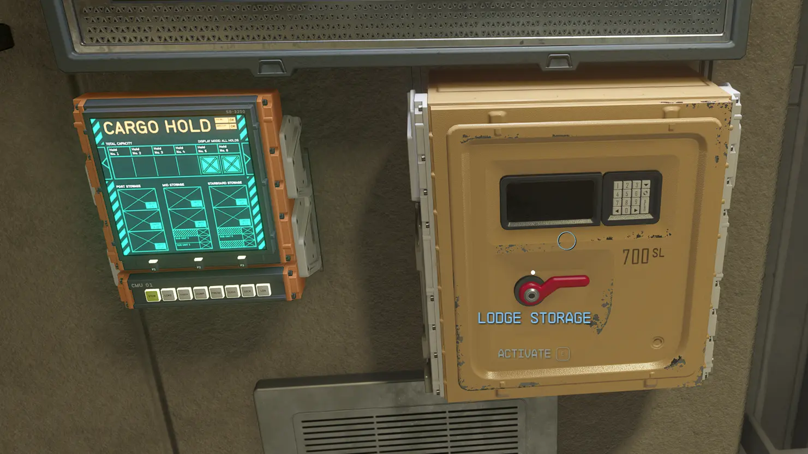
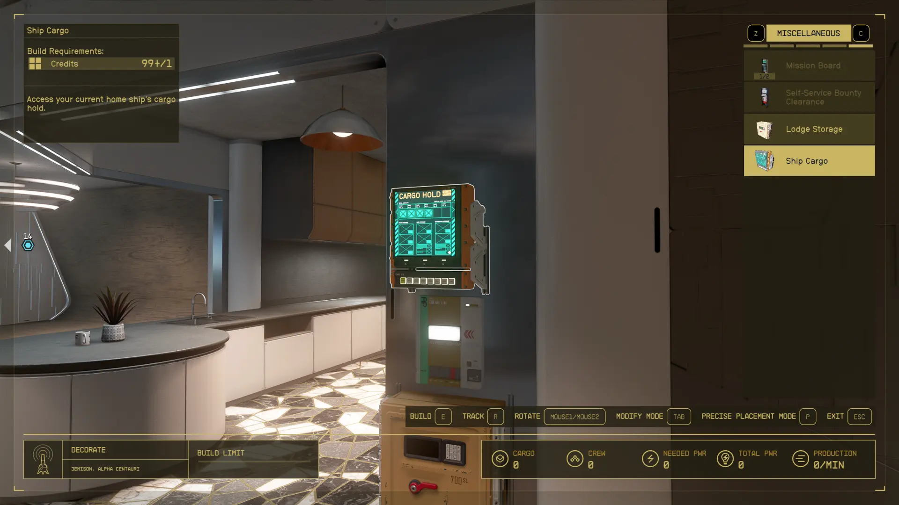

# Improved Lodge Storage

Starfield mod providing shared access to the Lodge bedroom safe, storage links for the Lodge basement's crafting stations, ship cargo access, and buildable storage access points for homes and outposts.

<p>
    <a href="src/screenshots/lodge.webp"></a>
    <a href="src/screenshots/starport.webp"></a>
    <a href="src/screenshots/build.webp"></a>
</p>

## Requirements

- [Starfield](https://store.steampowered.com/app/1716740/Starfield/)
- [Starfield: Creation Kit](https://store.steampowered.com/app/2722710/Starfield_Creation_Kit/)
- [.NET 10 SDK](https://dotnet.microsoft.com/en-us/download/dotnet/10.0)

## Building

The defaults use the standard Windows Steam installation path. On Linux or when using a different Windows installation path, copy `config.example.props` to `config.props` and set `GamePath` to your Starfield directory. On Linux, also set `WinePath` to Proton's Wine executable.

Run from the project directory:

```sh
dotnet build
```

The installable mod ZIP is created at `build/dist/ImprovedLodgeStorage-<version>.zip`. Set the version in the `.csproj` file's `<Version>` property.
